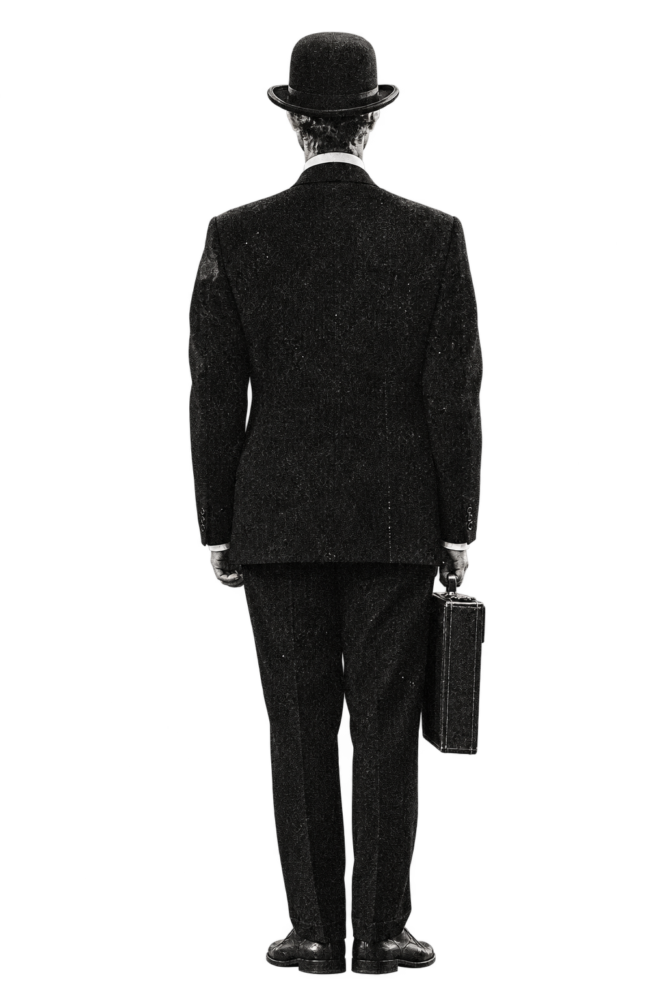

# Thrifted Tease — Character Asset Pack (10 PNGs)

Ten standalone PNG website assets inspired by the gentleman in the *Two Weeks Notice* album artwork:

- `bowler-hat.png` — vintage black bowler hat
- `briefcase.png` — black leather briefcase
- `oxford-shoes.png` — pair of vintage black dress shoes
- `suit-jacket-back.png` — suit jacket, rear view
- `full-character-back.png` — full standing figure with briefcase
- `walking-figure.png` — walking away, full body
- `double-hat-tip-figure.png` — surreal hat-tip pose (two visible bowler hats)
- `floating-hat.png` — dynamically tilted bowler hat
- `open-briefcase.png` — briefcase opened, empty interior
- `shoe-side-profile.png` — isolated side-view Oxford shoe

All PNGs have transparent alpha channels and are ready to layer in HTML/CSS. They are generated interpretations matching the album's look, not pixel-perfect cutouts of the original illustration.

Example use:

```html

```

```css
.character { width: min(28vw, 420px); height: auto; object-fit: contain; }
```

The full character works well for parallax scroll animation. Keep the smaller accessories as independent foreground elements or hover details.
