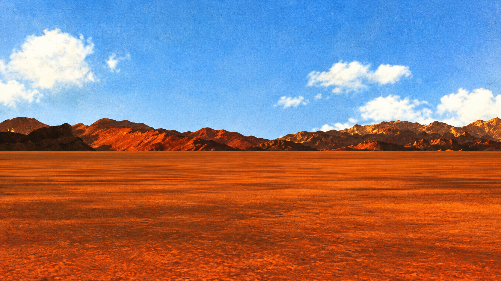
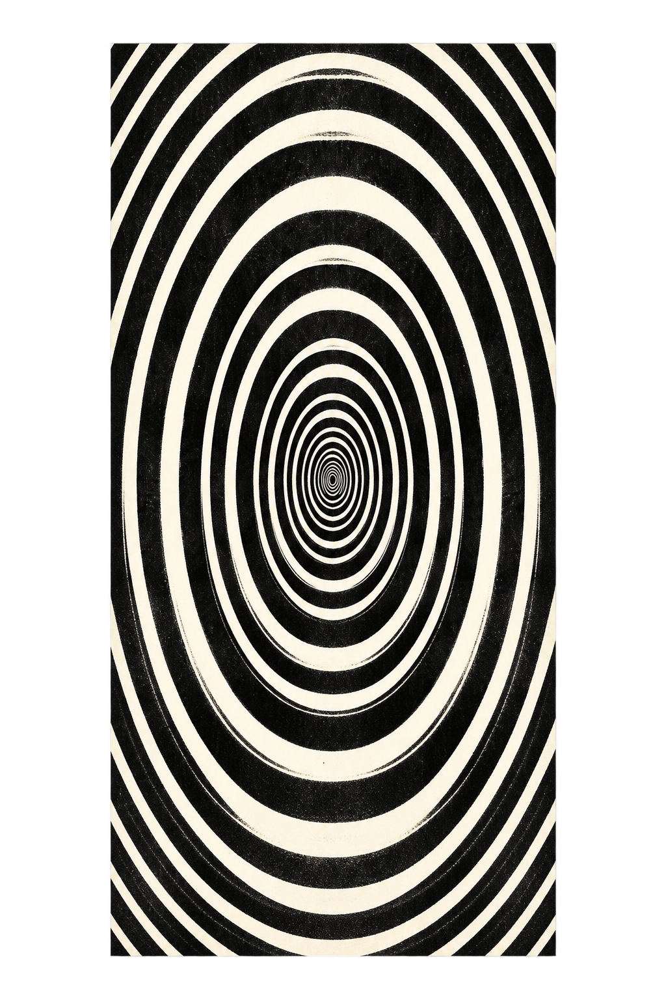
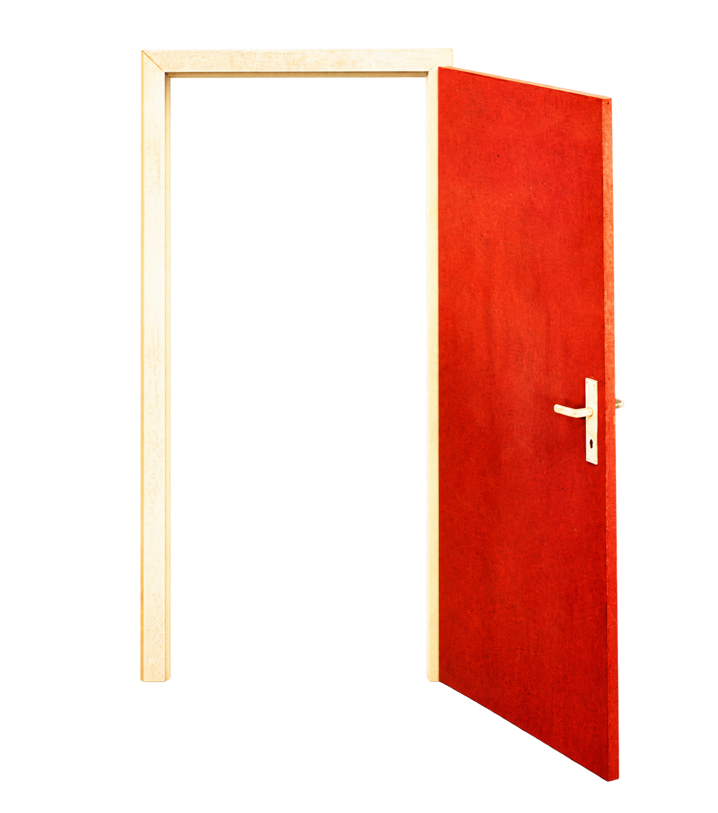

# Thrifted Tease — Two Weeks Notice World Asset Pack

13 high-resolution PNG images based on 10 creative concepts, generated using the supplied *Two Weeks Notice* album cover as the visual reference. Intended for the band's website. These are **generated interpretations**, not pixel-exact object extractions.

## Contents

| File | Role | Alpha | Suggested section |
|---|---|---|---|
| `hero/01-red-door-open-slab.png` | Isolated open door panel | Yes | Animated hero foreground |
| `hero/02-door-closed-frame.png` | Closed doorway | Yes | Intro state |
| `hero/02-door-open-frame.png` | Open doorway with transparent passage | Yes | Door transition |
| `hero/03-optical-portal.png` | Optical tunnel slab | Yes outside panel | Behind open doorway |
| `hero/04-desert-panorama.png` | Wide desert and sky | No | Hero/section background |
| `hero/05-cloud-cutouts.png` | Three clouds in one image | Yes | Sky parallax layer |
| `props/06-resignation-letter.png` | Blank-ish letter with stamp | Yes | About/release narrative |
| `props/07-time-punch-clock.png` | Mid-century clock machine | Yes | Shows/date motif |
| `props/08-departure-ticket.png` | Blank ticket cutout | Yes | Show cards/CTA |
| `hero/09-desert-shadow.png` | Long silhouette shadow | Yes | Desert foreground |
| `textures/10-film-grain-overlay.png` | Transparent dust/grain overlay | Yes | Global texture, subtle opacity |
| `textures/10-aged-paper-texture.png` | Cream paper surface | No | Cards and editorial panels |
| `textures/10-rust-ink-texture.png` | Burnt-orange worn ink | No | Buttons/section backgrounds |

## Important implementation notes

- **Door states are not frame-perfect animation frames.** Their perspective and dimensions differ slightly. Align their handles and doorway opening in a fixed aspect-ratio container, then use a short crossfade or mask transition. For a physically correct door swing, keep the doorway frame static and animate the separate door slab around its hinge with CSS `transform-origin`.
- **Optical portal:** layer it below `02-door-open-frame.png` so the transparent passage reveals the spiral. To avoid aliasing when zooming far into a raster spiral, consider rendering the deepest tunnel rings with CSS/SVG and using the PNG as the textured foreground.
- **Clouds:** the three cutouts share one image. Position the sheet as a single slow-moving layer or make independent crops later if needed.
- **Film grain:** use sparingly over the interface (e.g. CSS opacity around `0.08`–`0.18`); ensure contrast remains readable.
- **Paper textures:** designed to be tile-friendly but not guaranteed pixel-perfect seamless. Check visible seams before using `background-repeat` at large scale.
- **Tour ticket and resignation letter:** real text should be HTML on top, not embedded in the raster, for accessibility and easy editing.
- All generated PNGs should be optimized to WebP/AVIF for production delivery if browser support and tooling allow it; preserve PNG originals in the design source. Set intrinsic dimensions to avoid layout shift and lazy-load below-the-fold decorative imagery.
- Honor `prefers-reduced-motion`, provide a skip-intro link, and keep music/show links accessible independently of the hero animation.

## Simple stacking example

```html
<div class="world">
  
  
  
</div>
```

```css
.world { position: relative; width: 100%; aspect-ratio: 16 / 9; overflow: hidden; }
.world img { position: absolute; display: block; }
.world__desert { inset: 0; width: 100%; height: 100%; object-fit: cover; }
.world__portal { height: 72%; left: 44%; top: 15%; transform: translateX(-50%); }
.world__door { height: 75%; left: 50%; top: 13%; transform: translateX(-50%); }
```

This is illustrative layout code; adjust positions after inspecting the actual site and the asset dimensions. The prior character pack can be stacked in front as the walking man.

## Creative direction

Keep the visual hierarchy of the original album cover: blue sky / rust desert / red door / black-white portal / warm ivory print texture. Use the new assets as a cohesive visual language, not decorative clutter on every page.
